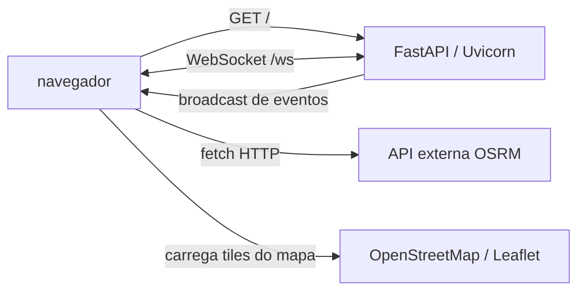
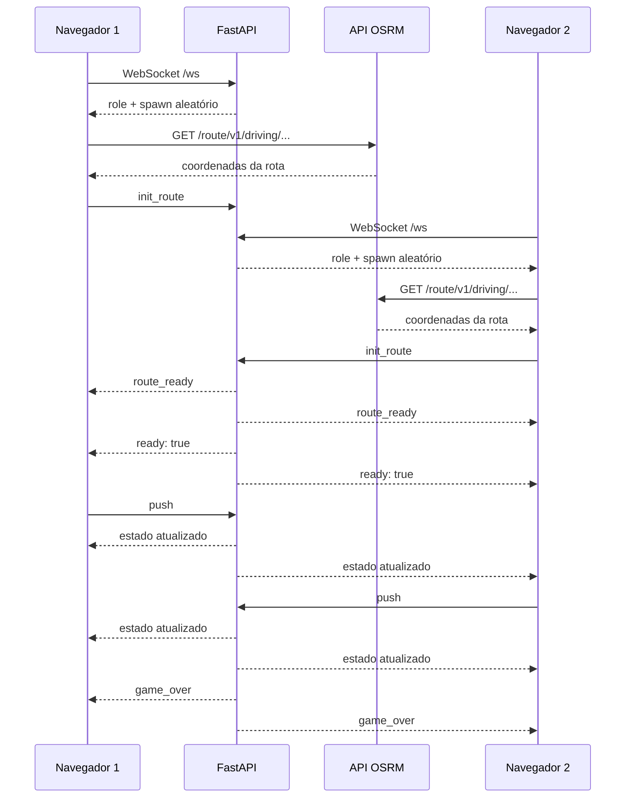

# Corrida para a Ponte Hercílio Luz — FastAPI Showcase

Aplicação didática que demonstra, em um único projeto Python, como utilizar **FastAPI**, **rotas HTTP/REST**, **WebSocket**, **OpenAPI**, **HTMLResponse**, integração com uma API externa de rotas e transmissão de eventos em tempo real.

O usuário controla um veículo em um mapa de Florianópolis. Dois jogadores competem para chegar à Ponte Hercílio Luz. Cada jogador recebe um ponto de saída aleatório, uma rota é calculada e cada clique no botão `PUSH!` avança o veículo.

> Este README utiliza uma abordagem **white-box**: além de explicar o que a aplicação faz, mostra como ela funciona internamente, quais dados circulam entre cliente e servidor e em que partes do código cada comportamento é implementado.

---

## 1. Objetivos didáticos

Ao estudar este projeto, é possível compreender:

- como criar uma aplicação com FastAPI;
- como declarar uma rota HTTP com `@app.get()`;
- como retornar HTML usando `HTMLResponse`;
- como criar endpoints REST que retornam JSON;
- como criar uma conexão WebSocket com `@app.websocket()`;
- como fazer comunicação bidirecional em tempo real;
- como manter estado temporário no servidor;
- como transmitir eventos para vários clientes;
- como integrar o navegador com uma API externa de rotas;
- como o FastAPI gera documentação OpenAPI automaticamente;
- como separar o estado interno do servidor do estado público enviado pela API.

---

## 2. Visão geral da arquitetura

A aplicação possui três participantes principais:



### Componentes

| Componente | Responsabilidade |
|---|---|
| `FastAPI` | Cria a aplicação e registra as rotas. |
| `Uvicorn` | Executa o servidor ASGI. |
| `GET /` | Entrega a página HTML do jogo. |
| `GET /api/status` | Retorna o estado público da corrida em JSON. |
| `GET /api/health` | Informa se a API está disponível. |
| `WebSocket /ws` | Mantém comunicação em tempo real com os jogadores. |
| Leaflet | Renderiza o mapa no navegador. |
| OpenStreetMap | Fornece as imagens dos mapas. |
| OSRM | Calcula a rota de carro entre a largada e a ponte. |

---

## 3. Estrutura do projeto

O projeto é composto por dois pontos de entrada principais:

```text
.
├── app.py                 # servidor FastAPI, regras do jogo e HTML do cliente
├── cliente_terminal.py    # cliente alternativo sem navegador, para executar pelo terminal
├── README.md              # documentação deste projeto
```

O arquivo `app.py` contém tanto o backend quanto a interface HTML/JavaScript. Essa organização é conveniente para um exemplo didático, pois permite estudar o fluxo completo em um único lugar. Em um projeto maior, seria recomendável separar o HTML, o CSS, o JavaScript e as regras do jogo em módulos próprios.

O arquivo `cliente_terminal.py` oferece uma alternativa para testar a mesma lógica do jogo sem abrir o navegador: ele consulta o endpoint REST `/api/status` e se conecta ao WebSocket `/ws` para enviar comandos de `push` e acompanhar a partida em tempo real.

---

## 4. Requisitos

- Python 3.9 ou superior;
- FastAPI;
- Uvicorn;
- `websockets` para o cliente de terminal;
- navegador moderno com suporte a WebSocket;
- conexão com a internet para carregar Leaflet, OpenStreetMap e OSRM.

Instalação das dependências:

```bash
pip install fastapi uvicorn websockets
```

Uma opção equivalente usando arquivo de dependências seria:

```bash
pip install "fastapi[standard]"
```

---

## 5. Como executar

Na pasta que contém `app.py`:

```bash
python3 app.py
```

O servidor será iniciado em:

```text
http://127.0.0.1:8000
```

Também é possível iniciar diretamente com Uvicorn:

```bash
uvicorn app:app --host 127.0.0.1 --port 8000 --reload
```

### Cliente de terminal (`cliente_terminal.py`)

O cliente de terminal é útil para testar a partida em modo texto, sem depender da UI do navegador. Ele faz duas coisas:

- consulta o estado da corrida em `GET /api/status`;
- conecta ao WebSocket `ws://.../ws` para receber atualizações e enviar comandos de `push`.

Para executar, abra dois terminais e rode o mesmo comando em cada um deles:

**HARD**

```bash
python cliente_terminal.py --api-url http://127.0.0.1:8000 --pushes 30 --intervalo 0.05
```

**MEDIUM**

```bash
python cliente_terminal.py --api-url http://127.0.0.1:8000 --pushes 30 --intervalo 1.50
```

**EASY**

```bash
python cliente_terminal.py --api-url http://127.0.0.1:8000 --pushes 30 --intervalo 3.00
```

Parâmetros:

- `--api-url`: URL base da API (padrão: `http://127.0.0.1:8000`);
- `--pushes`: quantidade máxima de `PUSH` enviados pelo cliente;
- `--intervalo`: pausa entre cada envio, em segundos.

Como cada instância representa um jogador, execute em dois terminais diferentes para que a partida tenha os dois participantes conectados ao mesmo tempo.

### Endereços importantes

| Endereço | Uso |
|---|---|
| `http://127.0.0.1:8000/` | Interface do jogo. |
| `http://127.0.0.1:8000/docs` | Swagger UI gerado pelo FastAPI. |
| `http://127.0.0.1:8000/redoc` | Documentação alternativa em ReDoc. |
| `http://127.0.0.1:8000/openapi.json` | Contrato OpenAPI em JSON. |
| `ws://127.0.0.1:8000/ws` | Endpoint WebSocket. |

---

## 6. Inicialização do FastAPI

No início de `app.py`, a aplicação é criada assim:

```python
app = FastAPI(
    title="Corrida para a Ponte Hercílio Luz - FastAPI Showcase",
    description=(
        "Exemplo didático de uma API FastAPI com rota HTTP, "
        "endpoint REST e comunicação WebSocket."
    ),
    version="1.0.0",
)
```

Esse objeto `app` é o núcleo da aplicação. Os decoradores utilizados posteriormente, como `@app.get()` e `@app.websocket()`, registram novas rotas nesse objeto.

### O que o FastAPI fornece automaticamente?

A partir da declaração das rotas, o FastAPI gera:

- validação e roteamento das requisições;
- respostas HTTP;
- documentação interativa;
- contrato OpenAPI;
- integração com servidores ASGI, como Uvicorn.

---

## 7. Tipos de API usados no projeto

O código demonstra três formas de interação.

### 7.1. Rota HTTP que entrega HTML

```python
@app.get("/")
async def get_game() -> HTMLResponse:
    ...
    return HTMLResponse(content=page_content)
```

Essa rota recebe uma requisição `GET /` e retorna a interface do jogo.

Fluxo:

```text
navegador
   │
   │ GET /
   ▼
FastAPI executa get_game()
   │
   │ HTMLResponse
   ▼
navegador renderiza HTML, CSS e JavaScript
```

Apesar de a resposta ser HTML, essa também é uma API HTTP: existe um método, uma URL, uma função no servidor e uma resposta.

### 7.2. API REST que retorna JSON

```python
@app.get(
    "/api/status",
    summary="Consultar o estado público da corrida",
    tags=["API REST"],
)
async def get_status() -> dict[str, Any]:
    ...
```

Essa rota é voltada para programas, ferramentas de monitoramento ou outros clientes que precisam consultar o estado da aplicação.

### 7.3. API WebSocket

```python
@app.websocket("/ws")
async def websocket_endpoint(websocket: WebSocket):
    ...
```

O WebSocket mantém uma conexão aberta. O navegador pode enviar mensagens ao servidor e o servidor pode enviar mensagens de volta sem que seja necessário abrir uma nova requisição HTTP a cada evento.

---

## 8. Endpoint `GET /api/health`

O endpoint de saúde é simples:

```python
@app.get(
    "/api/health",
    summary="Verificar se a API está disponível",
    tags=["API REST"],
)
async def health_check() -> dict[str, str]:
    return {"status": "ok", "service": "fastapi-race"}
```

### Teste com cURL

```bash
curl http://127.0.0.1:8000/api/health
```

Resposta esperada:

```json
{
  "status": "ok",
  "service": "fastapi-race"
}
```

### Para que serve?

Esse endpoint pode ser utilizado por:

- verificações de disponibilidade;
- balanceadores de carga;
- serviços de monitoramento;
- scripts de implantação;
- testes automatizados.

Ele não consulta o estado completo do jogo. Sua finalidade é responder rapidamente se o serviço está ativo.

---

## 9. Endpoint `GET /api/status`

O endpoint de status retorna uma visão pública da partida:

```bash
curl http://127.0.0.1:8000/api/status
```

Exemplo de resposta:

```json
{
  "status": "ok",
  "game_state": {
    "game_over": false,
    "winner": null,
    "started": false,
    "player_1": {
      "lat": 0,
      "lon": 0,
      "clicks": 0,
      "max_clicks": 50,
      "connected": false,
      "route_ready": false
    },
    "player_2": {
      "lat": 0,
      "lon": 0,
      "clicks": 0,
      "max_clicks": 50,
      "connected": false,
      "route_ready": false
    }
  }
}
```

### Por que existe `get_public_game_state()`?

O servidor possui um estado interno que inclui objetos `WebSocket`:

```python
game_state["player_1"]["ws"]
```

Esse objeto é necessário para enviar mensagens, mas não é um dado JSON comum. Por isso, não devemos retornar diretamente todo o dicionário interno em uma resposta HTTP.

A função:

```python
def get_public_game_state() -> dict[str, Any]:
    ...
```

faz uma projeção segura do estado interno. Ela seleciona somente dados públicos:

- posição do jogador;
- quantidade de cliques;
- limite de cliques;
- conexão ativa;
- rota pronta;
- estado da partida;
- vencedor.

Essa separação é um princípio importante de APIs:

> O estado interno do servidor não precisa ser igual ao contrato público da API.

---

## 10. Estado interno do jogo

O estado é mantido em memória pelo dicionário `game_state`:

```python
game_state = {
    "game_over": False,
    "winner": None,
    "started": False,
    "player_1": {
        "lat": 0,
        "lon": 0,
        "route": [],
        "current_index": 0,
        "clicks": 0,
        "max_clicks": 50,
        "ws": None,
    },
    "player_2": {
        "lat": 0,
        "lon": 0,
        "route": [],
        "current_index": 0,
        "clicks": 0,
        "max_clicks": 50,
        "ws": None,
    },
}
```

### Campos globais

| Campo | Significado |
|---|---|
| `game_over` | Indica se a corrida terminou. |
| `winner` | Guarda `player_1`, `player_2` ou `None`. |
| `started` | Indica se os dois jogadores estão prontos para correr. |

### Campos de cada jogador

| Campo | Significado |
|---|---|
| `lat` | Latitude atual. |
| `lon` | Longitude atual. |
| `route` | Lista de pontos da rota. |
| `current_index` | Índice atual dentro da rota. |
| `clicks` | Quantidade de cliques recebidos. |
| `max_clicks` | Número máximo de cliques. |
| `ws` | Objeto da conexão WebSocket ativa. |

> Este estado é apenas em memória. Se o processo for reiniciado, os dados são perdidos. Em produção, seria necessário utilizar um banco de dados, Redis ou outro mecanismo compartilhado.

---

## 11. Pontos aleatórios de saída

Cada jogador possui um conjunto próprio de pontos possíveis:

```python
SPAWN_POINTS = {
    "player_1": [
        [-27.5849, -48.5451],
        [-27.5894, -48.5517],
        [-27.5788, -48.5417],
        [-27.5962, -48.5489],
    ],
    "player_2": [
        [-27.6015, -48.5645],
        [-27.6052, -48.5713],
        [-27.5939, -48.5796],
        [-27.6082, -48.5570],
    ],
}
```

A função `get_random_spawn()` escolhe um ponto e acrescenta uma pequena variação:

```python
def get_random_spawn(player_key: str) -> list[float]:
    base_lat, base_lon = random.choice(SPAWN_POINTS[player_key])
    return [
        round(base_lat + random.uniform(-0.0003, 0.0003), 6),
        round(base_lon + random.uniform(-0.0003, 0.0003), 6),
    ]
```

O sorteio acontece quando o cliente se conecta ao WebSocket:

```python
spawn_lat, spawn_lon = get_random_spawn(player_key)
```

Assim, duas partidas consecutivas podem começar em pontos diferentes.

---

## 12. Rota WebSocket `/ws`

A rota WebSocket é responsável por registrar jogadores, receber comandos e transmitir atualizações.

```python
@app.websocket("/ws")
async def websocket_endpoint(websocket: WebSocket):
    await websocket.accept()
```

O método `accept()` conclui o handshake WebSocket. Depois disso, a conexão permanece aberta.

### Escolha do jogador

O primeiro cliente recebe `player_1`. O segundo recebe `player_2`:

```python
if game_state["player_1"]["ws"] is None:
    player_key = "player_1"
elif game_state["player_2"]["ws"] is None:
    player_key = "player_2"
```

Se os dois lugares estiverem ocupados, o servidor fecha a conexão:

```python
await websocket.close(code=1008, reason="Sala cheia")
```

O código `1008` representa uma violação de política, usado aqui para indicar que a sala está cheia.

### Mensagem inicial enviada ao jogador

Após o sorteio da largada, o servidor envia:

```json
{
  "role": "player_1",
  "spawn_lat": -27.584712,
  "spawn_lon": -48.545203
}
```

O navegador usa essa mensagem para:

- descobrir qual jogador representa;
- posicionar o marcador no mapa;
- ajustar o enquadramento do mapa;
- iniciar a busca da rota.

---

## 13. Contrato de mensagens WebSocket

O WebSocket funciona como uma API baseada em mensagens. O campo `type` identifica a operação.

### 13.1. `init_route`

Enviado pelo navegador quando o OSRM retorna uma rota:

```json
{
  "type": "init_route",
  "player": "player_1",
  "coords": [
    [-27.5847, -48.5452],
    [-27.5841, -48.5490],
    [-27.5938, -48.5661]
  ]
}
```

O servidor:

1. recebe as coordenadas;
2. interpola a rota para 50 passos;
3. armazena a rota no estado do jogador;
4. informa os clientes com `route_ready`;
5. verifica se a corrida pode começar.

### 13.2. `init_route_fallback`

Enviado quando o OSRM não responde ou retorna uma rota inválida:

```json
{
  "type": "init_route_fallback",
  "player": "player_1"
}
```

O servidor utiliza uma rota pré-definida, mas substitui o primeiro ponto pela largada aleatória atual:

```python
spawn_coords = [
    game_state[p_target]["lat"],
    game_state[p_target]["lon"],
]

sampled_route = interpolate_route(
    get_fallback_route(p_target, spawn_coords),
    target_steps=50,
)
```

Essa substituição evita que o marcador salte do ponto sorteado para um ponto fixo antigo.

### 13.3. `push`

Enviado ao pressionar o botão ou a tecla `Espaço`/`Enter`:

```json
{
  "type": "push"
}
```

O servidor:

1. verifica se a corrida começou;
2. incrementa `clicks`;
3. calcula o índice do próximo ponto;
4. atualiza latitude e longitude;
5. transmite o novo estado para os clientes;
6. verifica se houve vitória.

### 13.4. `restart`

Solicita uma nova rodada:

```json
{
  "type": "restart"
}
```

O servidor zera:

- `game_over`;
- `winner`;
- `started`;
- `clicks`;
- `current_index`.

As conexões dos jogadores continuam ativas. O próximo ciclo usa as rotas já armazenadas.

---

## 14. Fluxo completo de uma partida



### Condição para iniciar

A função `check_and_start_race()` libera a corrida somente quando:

```python
if len(p1["route"]) > 0 and len(p2["route"]) > 0 and p1["ws"] and p2["ws"]:
```

Ou seja:

- o Jogador 1 está conectado;
- o Jogador 2 está conectado;
- a rota do Jogador 1 está pronta;
- a rota do Jogador 2 está pronta.

Quando isso ocorre:

```python
game_state["started"] = True
await broadcast({"ready": True})
```

---

## 15. Integração com o OSRM

O navegador monta uma URL para a API pública do OSRM:

```javascript
const url =
  "https://router.project-osrm.org/route/v1/driving/" +
  start[1] + "," + start[0] + ";" +
  end[1] + "," + end[0] +
  "?overview=full&geometries=geojson";
```

### Atenção à ordem das coordenadas

O mapa Leaflet usa normalmente:

```text
[latitude, longitude]
```

O OSRM espera:

```text
longitude,latitude
```

Por isso, o código troca a ordem ao montar a URL:

```javascript
start[1] + "," + start[0]
```

Quando o OSRM responde em GeoJSON, as coordenadas voltam como:

```text
[longitude, latitude]
```

O código converte novamente para o formato usado pelo Leaflet:

```javascript
const coordinates = data.routes[0].geometry.coordinates.map(
  coord => [coord[1], coord[0]]
);
```

### Tratamento de erro

Se a chamada falhar:

```javascript
.catch(err => {
  ws.send(JSON.stringify({
    type: "init_route_fallback",
    player: player
  }));
});
```

O jogo continua funcionando com uma rota de contingência local.

---

## 16. Broadcast para os jogadores

A função `broadcast()` envia a mesma mensagem para os dois clientes:

```python
async def broadcast(data_dict):
    payload = json.dumps(data_dict)

    for p_key in ["player_1", "player_2"]:
        ws = game_state[p_key]["ws"]
        if ws:
            try:
                await ws.send_text(payload)
            except Exception:
                pass
```

Essa função é utilizada para enviar:

- logs de rotas;
- rotas prontas;
- autorização de largada;
- estado da partida;
- resultado final.

### Estado enviado após cada clique

```python
async def broadcast_game_state():
    await broadcast(get_public_game_state())
```

O estado enviado pelo WebSocket usa a mesma projeção pública utilizada pelo endpoint REST. Isso evita duplicação e reduz o risco de REST e WebSocket utilizarem formatos diferentes.

---

## 17. Logs de execução das rotas

A função `send_route_log()` transforma eventos internos em mensagens visíveis no painel do navegador:

```python
async def send_route_log(route_name: str, method: str, detail: str):
    payload = {
        "type": "route_log",
        "timestamp": now,
        "route": route_name,
        "method": method,
        "detail": detail,
    }
    await broadcast(payload)
```

Exemplo de mensagem:

```json
{
  "type": "route_log",
  "timestamp": "14:32:10.123",
  "route": "@app.websocket('/ws')",
  "method": "WEBSOCKET",
  "detail": "Mensagem 'push' processada para player_1"
}
```

No cliente, a mensagem é detectada assim:

```javascript
if (data.type === "route_log") {
  addRouteLog(data.route, data.method, data.detail, data.timestamp);
  return;
}
```

Esse mecanismo torna visível a diferença entre:

- uma rota HTTP tradicional, como `@app.get('/api/status')`;
- uma rota WebSocket, como `@app.websocket('/ws')`.

---

## 18. Cliente JavaScript e conexão WebSocket

O navegador define o protocolo dinamicamente:

```javascript
const protocol = window.location.protocol === "https:"
  ? "wss://"
  : "ws://";

const wsUrl = protocol + window.location.host + "/ws";
ws = new WebSocket(wsUrl);
```

Isso permite que o mesmo código funcione em:

- HTTP local com `ws://`;
- HTTPS em produção com `wss://`.

### Eventos principais

#### Conexão aberta

```javascript
ws.onopen = function() {
  // atualiza o indicador para "WebSocket Conectado"
};
```

#### Mensagem recebida

```javascript
ws.onmessage = function(event) {
  const data = JSON.parse(event.data);
  // interpreta a mensagem conforme seu conteúdo
};
```

#### Conexão encerrada

```javascript
ws.onclose = function() {
  // desabilita o botão e informa a desconexão
};
```

---

## 19. Documentação OpenAPI

As rotas HTTP aparecem automaticamente em:

```text
http://127.0.0.1:8000/docs
```

O FastAPI identifica declarações como:

```python
@app.get("/api/health")
@app.get("/api/status")
```

E cria uma documentação navegável.

Também é possível acessar o JSON do contrato:

```bash
curl http://127.0.0.1:8000/openapi.json
```

Exemplo para listar as rotas HTTP documentadas:

```bash
curl -s http://127.0.0.1:8000/openapi.json \
  | python3 -c 'import json, sys; print(json.load(sys.stdin)["paths"].keys())'
```

### Observação sobre WebSocket

O WebSocket é uma conexão persistente e não uma rota HTTP convencional. Por isso, ele não aparece necessariamente na seção `paths` do OpenAPI como aparece uma rota `GET` ou `POST`. No projeto, ele é documentado por comentários, pelo painel visual e por este README.

---

## 20. Testes rápidos

### Verificar compilação

```bash
python3 -m py_compile app.py
```

### Verificar saúde da API

```bash
curl -i http://127.0.0.1:8000/api/health
```

Esperado:

```text
HTTP/1.1 200 OK
```

### Consultar status

```bash
curl -s http://127.0.0.1:8000/api/status | python3 -m json.tool
```

### Testar a variedade das largadas

```bash
python3 - <<'PY'
from app import get_random_spawn

for player in ("player_1", "player_2"):
    points = [tuple(get_random_spawn(player)) for _ in range(10)]
    print(player, len(set(points)), "pontos diferentes")
PY
```

### Testar WebSocket com Python

Instale o cliente:

```bash
pip install websockets
```

Depois:

```python
import asyncio
import json
import websockets


async def main():
    async with websockets.connect("ws://127.0.0.1:8000/ws") as ws:
        first_message = json.loads(await ws.recv())
        print("Mensagem inicial:", first_message)

        await ws.send(json.dumps({"type": "init_route_fallback", "player": first_message["role"]}))
        print("Resposta:", await ws.recv())


asyncio.run(main())
```

Para liberar a corrida, é necessário conectar dois clientes e enviar uma rota para cada jogador.

---

## 21. Exemplo de cliente WebSocket mínimo

Um cliente JavaScript simplificado pode ser escrito assim:

```javascript
const ws = new WebSocket("ws://127.0.0.1:8000/ws");

ws.onopen = () => {
  console.log("Conectado");
};

ws.onmessage = (event) => {
  const data = JSON.parse(event.data);
  console.log("Servidor enviou:", data);

  if (data.role) {
    ws.send(JSON.stringify({
      type: "init_route_fallback",
      player: data.role
    }));
  }
};

function push() {
  ws.send(JSON.stringify({ type: "push" }));
}
```

Esse exemplo mostra a característica principal do WebSocket: depois de uma única conexão, várias mensagens podem ser trocadas nos dois sentidos.

---

## 22. Diferença entre HTTP e WebSocket neste projeto

| Característica | HTTP/REST | WebSocket |
|---|---|---|
| Exemplo | `GET /api/status` | `WS /ws` |
| Comunicação | Requisição e resposta | Canal persistente bidirecional |
| Uso no projeto | Consulta de status e health check | Jogo em tempo real |
| Frequência | Quando o cliente solicita | Sempre que um evento ocorre |
| Formato | JSON ou HTML | Mensagens JSON |
| Estado da conexão | Normalmente curta | Mantida aberta |
| Melhor aplicação | Consultas pontuais | Atualizações instantâneas |

Uma chamada HTTP seria adequada para perguntar:

```text
Qual é o estado atual?
```

O WebSocket é mais adequado para informar:

```text
O jogador acabou de clicar. Atualize todos os clientes agora.
```

---

## 23. Cuidados e limitações atuais

### Estado em memória

O jogo só funciona corretamente dentro de um único processo. Em um ambiente com vários workers ou várias máquinas, cada processo teria seu próprio `game_state`.

Possíveis soluções para produção:

- Redis para estado e publicação de eventos;
- banco de dados para partidas persistentes;
- gerenciador de sessões;
- serviço dedicado de WebSocket.

### Validação das mensagens

As mensagens WebSocket atualmente são dicionários JSON interpretados manualmente. Em uma aplicação real, seria interessante usar modelos Pydantic para validar:

- `type` permitido;
- jogador autorizado;
- formato das coordenadas;
- tamanho máximo da rota;
- limites de cliques.

### Segurança

O exemplo não possui autenticação. Qualquer cliente que acessar `/ws` pode tentar entrar na sala. Em produção, seria recomendável adicionar:

- autenticação;
- identificação de sessão;
- validação de origem;
- limites de requisições;
- tratamento mais rigoroso de erros;
- logs no servidor;
- política de privacidade para localização.

### API pública do OSRM

A aplicação utiliza uma instância pública do OSRM. Serviços públicos podem ter limites de uso, indisponibilidade ou políticas próprias. Para maior confiabilidade, deve-se considerar uma instância própria ou um provedor contratado.

### CORS

Se o frontend for separado do backend e estiver em outro domínio ou porta, será necessário configurar `CORSMiddleware` no FastAPI.

Exemplo:

```python
from fastapi.middleware.cors import CORSMiddleware

app.add_middleware(
    CORSMiddleware,
    allow_origins=["http://localhost:3000"],
    allow_credentials=True,
    allow_methods=["*"],
    allow_headers=["*"],
)
```

---

## 24. Possível evolução para uma API mais estruturada

Uma evolução natural seria separar os modelos da API usando Pydantic:

```python
from pydantic import BaseModel


class PlayerStatus(BaseModel):
    lat: float
    lon: float
    clicks: int
    max_clicks: int
    connected: bool
    route_ready: bool


class GameStatus(BaseModel):
    game_over: bool
    winner: str | None
    started: bool
    player_1: PlayerStatus
    player_2: PlayerStatus
```

A rota poderia declarar seu retorno:

```python
@app.get("/api/status", response_model=GameStatus)
async def get_status() -> GameStatus:
    ...
```

Benefícios:

- contrato mais explícito;
- validação automática;
- documentação OpenAPI mais detalhada;
- melhor suporte de IDE;
- menos risco de retornar campos incorretos.

---

## 25. Resumo do fluxo interno

1. O processo inicia o objeto `FastAPI`.
2. O Uvicorn disponibiliza o servidor na porta `8000`.
3. O navegador acessa `GET /`.
4. O FastAPI retorna o HTML do jogo.
5. O JavaScript abre `WebSocket /ws`.
6. O servidor atribui `player_1` ou `player_2`.
7. O servidor sorteia uma coordenada de saída.
8. O navegador solicita uma rota ao OSRM.
9. O navegador envia `init_route` ou `init_route_fallback`.
10. O servidor aguarda as duas rotas.
11. O servidor envia `ready: true`.
12. Cada clique envia `push` pelo WebSocket.
13. O servidor atualiza o estado em memória.
14. `broadcast_game_state()` envia o novo estado aos jogadores.
15. Ao atingir o destino, o servidor define `game_over` e `winner`.
16. O cliente mostra o resultado e pode enviar `restart`.

---

## 26. Conclusão

Este projeto é um exemplo compacto de uma aplicação em que diferentes estilos de API trabalham juntos:

- **HTTP/REST** fornece endpoints simples e consultáveis;
- **HTMLResponse** entrega a interface inicial;
- **WebSocket** mantém o jogo sincronizado em tempo real;
- **OSRM** demonstra integração com uma API externa;
- **OpenAPI** documenta automaticamente as rotas HTTP;
- **estado público** protege a separação entre dados internos e dados expostos.

A principal ideia arquitetural é escolher o tipo de comunicação conforme a necessidade:

> Use HTTP para consultas e respostas pontuais. Use WebSocket quando o servidor e o cliente precisarem trocar eventos continuamente em tempo real.

---

Desenvolvido por [Julio Cesar Bueno de Oliveira](https://www.linkedin.com/in/jcbdeoliveira/)

🐙 GitHub: [jcbdoliveira](https://github.com/jcbdoliveira/)
💼 LinkedIn: [Julio Cesar Bueno de Oliveira | LinkedIn](https://www.linkedin.com/in/jcbdeoliveira/)
